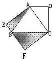

# Mathematics (Grade 5)

**ID**: 04a7c4f1
**难度**: medium_hard
**题型**: short_answer

## 题目
如图，ABCD是直角梯形，AEFC是长方形，已知BC-AD=6厘米，CD=8厘米，梯形面积是80平厘米．求阴影部分的面积．

## 解答

**答案**: 52

1. Step1:根据梯形面积公式S=(上底 + 下底)×高÷2，已知梯形面积S = 80平方厘米，高CD = 8厘米，设AD为上底，BC为下底，可得(BC + AD)×8÷2 = 80，化简得BC + AD = 20
2. Step2:又已知BC - AD = 6厘米，联立方程BC + AD = 20和BC - AD = 6，两式相加可得2BC = 26，解得BC = 13厘米
3. Step3:将BC = 13厘米代入BC + AD = 20，可得AD = 7厘米
4. Step4:因为AEFC是长方形，所以△ABC的高等于CD = 8厘米，又因为阴影部分面积等于S$_{△ABC}$，根据三角形面积公式S = 底×高÷2，底为BC = 13厘米，高为8厘米，所以S$_{△ABC}$ = 13×8÷2 = 52平方厘米

## 知识点

**知识点**:
  - 组合图形的面积．

---
