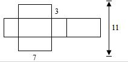

# Mathematics (Grade 5)

**ID**: 0bd450d2
**难度**: medium_hard
**题型**: short_answer

## 题目
如图是一个长方体的展开图，请同学们看图列式计算它的棱长总和及表面积．（单位：cm）

## 解答

**答案**: 48, 142

1. Step1:根据展开图可知长方体的长是7厘米
2. Step2:计算长方体的宽，由11-3-3=5厘米
3. Step3:由展开图得出长方体的高是3厘米
4. Step4:根据长方体棱长总和公式，计算棱长总和为(7+5+3)×4=15×4=60厘米
5. Step5:根据长方体表面积公式，计算表面积为(7×5+7×3+5×3)×2=(35+21+15)×2=71×2=142平方厘米
6. Step6:得出棱长总和是60厘米，将其作为答案的第一个元素
7. Step7:得出表面积是142平方厘米，将其作为答案的第二个元素
8. Step8:整理答案为['60', '142']

## 知识点

**知识点**:
  - 长方体和正方体的表面积;长方体的展开图

---
