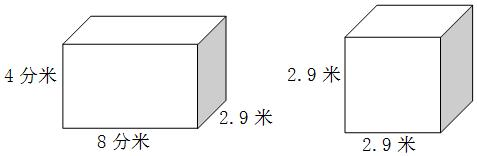

# Mathematics (Grade 5)

**ID**: 0c753298
**难度**: medium_hard
**题型**: short_answer

## 题目
计算下面长方体和正方体的表面积和体积．

## 解答

**答案**: 760, 928, 50.46, 24.389

1. Step1:将长方体的长8分米、宽2.9米（29分米）、高4分米代入长方体表面积公式S = 2(ab + ah + bh)，即(8×29 + 8×4 + 29×4)×2，先计算括号内(232 + 32 + 116)×2，再计算380×2得到760平方分米
2. Step2:将长方体的长8分米、宽29分米、高4分米代入长方体体积公式V = abh，即8×29×4，先计算232×4得到928立方分米
3. Step3:将正方体的棱长2.9米代入正方体表面积公式S = 6a²，即2.9×2.9×6，先计算8.41×6得到50.46平方米
4. Step4:将正方体的棱长2.9米代入正方体体积公式V = a³，即2.9×2.9×2.9，先计算8.41×2.9得到24.389立方米

## 知识点

**知识点**:
  - 长方体和正方体的体积;长方体和正方体的表面积

---
