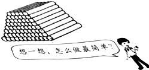

# Mathematics (Grade 5)

**ID**: 0cca1052
**难度**: medium_hard
**题型**: short_answer

## 题目
如图，一堆钢管呈梯形放置，相邻的两层都相差一根，每根钢管重350千克，这堆钢管重多少吨？

## 解答

**答案**: 23.8

1. Step1:确定最上层钢管数量为5根
2. Step2:确定最下层钢管数量为12根
3. Step3:计算钢管层数为12 - 5 + 1 = 8层
4. Step4:根据梯形面积公式计算钢管数量为(5 + 12)×8÷2 = 68根
5. Step5:计算钢管总重量为68×350 = 23800千克
6. Step6:将总重量单位换算为吨，23800千克 = 23.8吨

## 知识点

**知识点**:
  - 梯形的面积

---
