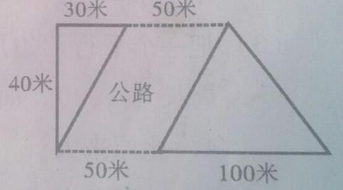

# Mathematics (Grade 5)

**ID**: 1141961a
**难度**: medium_hard
**题型**: short_answer

## 题目
如图一条新修筑的公路穿过一块菜地，这块菜地的面积是公路占去的面积的几倍？

## 解答

**答案**: 23

1. Step1:根据梯形面积公式（上底 + 下底）× 高 ÷ 2，计算菜地面积，上底为30 + 50 = 80米，下底为50 + 100 = 150米，高为40米，即(80 + 150)×40÷2 = 230×40÷2 = 9200÷2 = 4600平方米
2. Step2:根据平行四边形面积公式底×高，计算公路面积，底为50米，高为40米，即50×40 = 2000平方米
3. Step3:用菜地面积除以公路面积，即4600÷2000 = 23

## 知识点

**知识点**:
  - --

---
