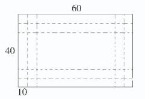

# Mathematics (Grade 5)

**ID**: 166e5932
**难度**: medium_hard
**题型**: short_answer

## 题目
手工课上，小明用一张长60厘米、宽40厘米的长方形的四角各剪去一个边长为10厘米的正方形，再制成纸盒（如下图）。这个纸盒的容积是多少？

## 解答

**答案**: 8000

1. Step1:计算纸盒的长，由长方形长60厘米，四角各剪去边长10厘米的正方形，可得长为60 - 10×2 = 40厘米
2. Step2:计算纸盒的宽，由长方形宽40厘米，四角各剪去边长10厘米的正方形，可得宽为40 - 10×2 = 20厘米
3. Step3:确定纸盒的高为剪去的正方形的边长，即10厘米
4. Step4:根据长方体容积公式（容积计算方法和体积相同），长方体容积=长×宽×高，计算纸盒容积为40×20×10 = 8000立方厘米
5. Step5:将纸盒容积的数值8000作为答案

## 知识点

**知识点**:
  - 长、正方体体积的计算

---
