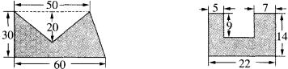

# Mathematics (Grade 5)

**ID**: 18e148b6
**难度**: medium_hard
**题型**: short_answer

## 题目
求下列图形中涂色部分的面积．(单位：cm)

## 解答

**答案**: 1150, 218

1. Step1:计算第一个图形中梯形的面积，根据梯形面积公式S=(a+b)h÷2（其中a=50，b=60，h=30），可得(50 + 60)×30÷2 = 110×30÷2 = 1650平方厘米
2. Step2:计算第一个图形中三角形的面积，根据三角形面积公式S=ah÷2（其中a=50，h=20），可得50×20÷2 = 500平方厘米
3. Step3:用第一个图形中梯形的面积减去三角形的面积，得到第一个图形涂色部分面积为1650 - 500 = 1150平方厘米
4. Step4:计算第二个图形中整个长方形的面积，根据长方形面积公式S=ab（其中a=22，b=14），可得22×14 = 308平方厘米
5. Step5:计算第二个图形中空白长方形的长为22 - 5 - 7 = 10厘米，再根据长方形面积公式计算其面积为10×9 = 90平方厘米
6. Step6:用第二个图形中整个长方形的面积减去空白长方形的面积，得到第二个图形涂色部分面积为308 - 90 = 218平方厘米

## 知识点

**知识点**:
  - 组合图形的面积．

---
