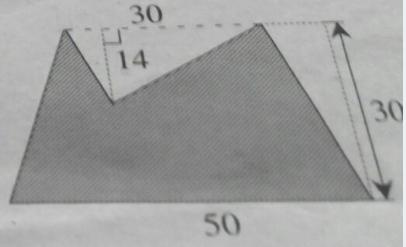

# Mathematics (Grade 5)

**ID**: 1cbaff97
**难度**: medium_hard
**题型**: short_answer

## 题目
下面是一个零件的平面图(阴影部分)，请你计算它的面积．(单位：cm)

 30  14  50  30

## 解答

**答案**: 990(cm²)

1. Step1:确定梯形的上底为30cm，下底为50cm，高为30cm，根据梯形面积公式可得梯形面积为(30 + 50)×30÷2
2. Step2:计算(30 + 50)×30÷2，先算括号里30 + 50 = 80，再算80×30 = 2400，最后2400÷2 = 1200，即梯形面积为1200cm²
3. Step3:确定空白三角形的底为30cm，高为14cm，根据三角形面积公式可得其面积为30×14÷2
4. Step4:计算30×14÷2，先算30×14 = 420，再算420÷2 = 210，即空白三角形面积为210cm²
5. Step5:用梯形面积1200cm²减去空白三角形面积210cm²，1200 - 210 = 990cm²，得到阴影部分面积

## 知识点

**知识点**:
  - --

---
