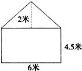

# Mathematics (Grade 5)

**ID**: 1eac64ef
**难度**: medium_hard
**题型**: short_answer

## 题目
如图是小王家侧面墙的平面图．现在要粉刷这面墙，如果每平方米用涂料200克，一共需要涂料多少千克？

## 解答

**答案**: 6.6

1. Step1:将200克换算为千克，200克 = 0.2千克
2. Step2:根据三角形面积公式S = 底×高÷2，计算三角形面积，底为6米，高为2米，即6×2÷2 = 6平方米
3. Step3:根据长方形面积公式S = 长×宽，计算长方形面积，长为6米，宽为4.5米，即6×4.5 = 27平方米
4. Step4:计算这面墙的总面积，为三角形面积与长方形面积之和，即6 + 27 = 33平方米
5. Step5:用墙的总面积乘每平方米用涂料的重量0.2千克，得到需要涂料的重量，即0.2×33 = 6.6千克

## 知识点

**知识点**:
  - 组合图形的面积．

---
