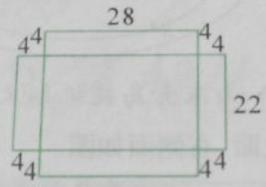

# Mathematics (Grade 5)

**ID**: 223f9ee0
**难度**: medium_hard
**题型**: short_answer

## 题目
五、下面是一个长方体无盖铁盒的展开图．（单位： cm）

 28   4   4   4  4  4  4  4  4  22
 1、做这个铁盒至少需要多少铁皮？
 2、这个铁盒的容积是多少？

## 解答

**答案**: 1016, 448

1. Step1:求出长方体展开图完整长方形的长，为28 + 4 + 4 = 36（cm）
2. Step2:求出长方体展开图完整长方形的宽，为22 + 4 + 4 = 30（cm）
3. Step3:计算完整长方形的面积，即36×30 = 1080（cm²）
4. Step4:计算四个角上小正方形的面积，为4×4×4 = 64（cm²）
5. Step5:用完整长方形面积减去四个小正方形面积，得到做铁盒需要的铁皮面积，1080 - 64 = 1016（cm²）
6. Step6:根据展开图得出长方体铁盒的长为28cm，宽为4cm，高为4cm
7. Step7:根据长方体容积公式，计算铁盒容积为28×4×4 = 448（cm³）

## 知识点

**知识点**:
  - 

---
