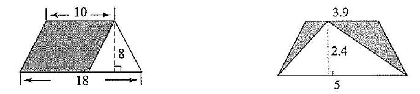

# Mathematics (Grade 5)

**ID**: 26cc1a0a
**难度**: medium_hard
**题型**: short_answer

## 题目
计算下列图中阴影部分的面积。（单位：cm）

 10  8  18  3.9  2.4  5

## 解答

**答案**: 80, 4.68

1. Step1:计算图一中梯形的上底为10cm，下底为18cm，高为8cm，根据梯形面积公式S=(a+b)×h÷2，可得梯形面积为(10 + 18)×8÷2 = 112平方厘米
2. Step2:计算图一中三角形的底为18 - 10 = 8cm，高为8cm，根据三角形面积公式S = a×h÷2，可得三角形面积为8×8÷2 = 32平方厘米
3. Step3:用图一中梯形面积减去三角形面积，得到图一阴影部分面积为112 - 32 = 80平方厘米
4. Step4:计算图二中梯形的上底为3.9cm，下底为5cm，高为2.4cm，根据梯形面积公式S=(a+b)×h÷2，可得梯形面积为(3.9 + 5)×2.4÷2 = 10.68平方厘米
5. Step5:计算图二中三角形的底为5cm，高为2.4cm，根据三角形面积公式S = a×h÷2，可得三角形面积为5×2.4÷2 = 6平方厘米
6. Step6:用图二中梯形面积减去三角形面积，得到图二阴影部分面积为10.68 - 6 = 4.68平方厘米

## 知识点

**知识点**:
  - 第六单元测试卷;第六单元测试卷

---
