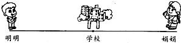

# Mathematics (Grade 5)

**ID**: 27589515
**难度**: medium_hard
**题型**: short_answer

## 题目
明明和娟娟同时从自家走向学校（如下图），明明每分走a米，娟娟每分走b米，经过4分，他们在校门口相遇．

（1）相遇时，明明、娟娟各走了多少米？
（2）明明和娟娟每分一共走了多少米？
（3）他们两家相距多少米？

## 解答

**答案**: 4a, 4b, (a+b), (4a+4b)

1. Step1:根据路程=速度×时间，明明的速度是每分a米，相遇时间是4分，所以相遇时明明走的路程为4×a = 4a米
2. Step2:同理，娟娟的速度是每分b米，相遇时间是4分，所以相遇时娟娟走的路程为4×b = 4b米
3. Step3:明明每分走a米，娟娟每分走b米，那么明明和娟娟每分一共走的路程为a + b米
4. Step4:两家的距离就是明明走的路程与娟娟走的路程之和，即4a + 4b米

## 知识点

**知识点**:
  - 简单的行程问题；用字母表示数．

---
