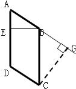

# Mathematics (Grade 5)

**ID**: 28b077e5
**难度**: medium_hard
**题型**: short_answer

## 题目
如图平行四边形ABCD的高CG 等于BE的2倍，平行四边形ABCD的面积是360平方厘米，AE=9厘米，AB=15厘米．求三角形ABE的面积．

## 解答

**答案**: 54

1. Step1:根据平行四边形面积公式S = 底×高，已知平行四边形ABCD面积是360平方厘米，底AB为15厘米，所以计算其高CG为360÷15 = 24厘米
2. Step2:因为平行四边形ABCD的高CG等于BE的2倍，所以计算BE的长度为24÷2 = 12厘米
3. Step3:已知三角形ABE中AE = 9厘米，BE = 12厘米，根据三角形面积公式S = 底×高÷2，计算三角形ABE面积为9×12÷2 = 54平方厘米

## 知识点

**知识点**:
  - 组合图形的面积．

---
