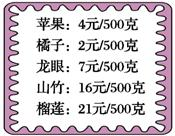

# Mathematics (Grade 5)

**ID**: 2c000f76
**难度**: medium_hard
**题型**: short_answer

## 题目
下图是“三果演义”水果店的水果标价牌。

(1)买500克山竹的钱可以买多少千克苹果?
(2)妈妈买了1千克龙眼和500克山竹,一共要花多少钱?
(3)你还能提出哪些数学问题?解答出来。

## 解答

**答案**: 2千克, 30元, 8元

1. Step1:计算500克山竹的钱可买苹果的份数，16÷4 = 4
2. Step2:计算这些份数对应的苹果重量，500×4 = 2000克
3. Step3:将苹果重量单位换算为千克，2000克 = 2千克
4. Step4:计算1千克龙眼的价格，因为1千克 = 1000克，1000÷500 = 2，2×7 = 14元
5. Step5:计算1千克龙眼和500克山竹的总花费，14 + 16 = 30元
6. Step6:提出问题“买1千克苹果花多少钱”，因为1千克 = 1000克，1000÷500 = 2，2×4 = 8元

## 知识点

**知识点**:
  - 小学数学;数与代数;常见的量;质量单位及换算;质量单位的换算;应用题;简单应用题;整数简单应用题

---
