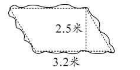

# Mathematics (Grade 5)

**ID**: 2f18e538
**难度**: medium_hard
**题型**: short_answer

## 题目
一块近似平行四边形的钢板（如图），若每平方米钢板重40千克，这块钢板大约重多少千克？

## 解答

**答案**: 320

1. Step1:根据平行四边形面积公式，确定底为3.2米，高为2.5米，计算面积为3.2×2.5 = 8平方米
2. Step2:已知每平方米钢板重40千克，用每平方米重量乘以钢板面积，即40×8 = 320千克

## 知识点

**知识点**:
  - 平行四边形的面积

---
