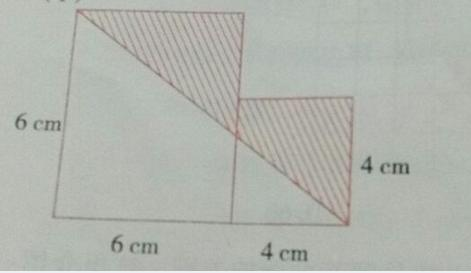

# Mathematics (Grade 5)

**ID**: 2f399fd7
**难度**: medium_hard
**题型**: short_answer

## 题目
求出阴影部分的面积。

$4cm$
  ；
  $4cm$
   ；
   $6cm$
    ；
    $6cm$
     .

## 解答

**答案**: 30

1. Step1:计算大正方形的面积，根据正方形面积公式$S = a^2$（其中$a$为边长），大正方形边长为6cm，所以面积为$6×6 = 36$平方厘米
2. Step2:计算小正方形的面积，小正方形边长为4cm，面积为$4×4 = 16$平方厘米
3. Step3:计算空白三角形的面积，根据三角形面积公式$S = \frac{1}{2}ah$（其中$a$为底，$h$为高），此三角形底为$6 + 4 = 10$cm，高为6cm，面积为$6×(6 + 4)×\frac{1}{2}= 30$平方厘米
4. Step4:用两个正方形面积之和减去空白三角形的面积得到阴影部分面积，即$36 + 16 - 30 = 30$平方厘米

## 知识点

**知识点**:
  - --

---
