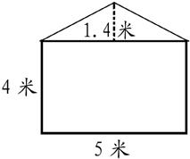

# Mathematics (Grade 5)

**ID**: 2f39f77e
**难度**: medium_hard
**题型**: short_answer

## 题目
如图是教室的一面墙，如果砌这面墙每平方米用砖160块，砌好这面墙至少需要多少块砖？

## 解答

**答案**: 3760

1. Step1:计算长方形的面积，长方形面积=长×宽，即4×5 = 20平方米
2. Step2:计算三角形的面积，三角形面积=底×高÷2，即5×1.4÷2 = 3.5平方米
3. Step3:计算墙面总面积，墙面总面积=长方形面积+三角形面积，即20 + 3.5 = 23.5平方米
4. Step4:计算所需砖的数量，所需砖的数量=墙面总面积×每平方米用砖数，即23.5×160 = 3760块

## 知识点

**知识点**:
  - 组合图形的面积．

---
