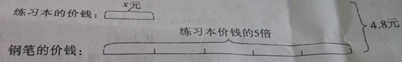

# Mathematics (Grade 5)

**ID**: 335a4697
**难度**: medium_hard
**题型**: short_answer

## 题目

 练习本的价钱：x元
 钢笔的价钱：练习本价钱的5倍   4.8
 一本练习本和一支钢笔各是多少元？

## 解答

**答案**: 0.8, 4

1. Step1:根据题意可知练习本价钱为x元，钢笔价钱是练习本价钱的5倍，即5x元，又知一本练习本和一支钢笔总共4.8元，所以可列方程x + 5x = 4.8
2. Step2:对x + 5x = 4.8进行计算，合并同类项得到6x = 4.8
3. Step3:由6x = 4.8，求解x，可得x = 4.8÷6 = 0.8
4. Step4:计算钢笔的价钱，因为钢笔价钱为5x，把x = 0.8代入，可得5×0.8 = 4
5. Step5:得出一本练习本0.8元，一支钢笔4元，答案为['0.8', '4']

## 知识点

**知识点**:
  - --

---
