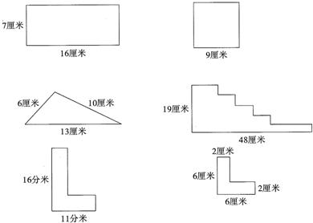

# Mathematics (Grade 5)

**ID**: 335e23a2
**难度**: medium_hard
**题型**: short_answer

## 题目
求下列图形的周长

## 解答

**答案**: 46（厘米）, 36（厘米）, 29（厘米）, 134（厘米）, 54（分米）, 24（厘米）

1. Step1:计算第一个长方形的周长，根据长方形周长公式（长+宽）×2，长为16厘米，宽为7厘米，即(16 + 7)×2 = 23×2 = 46（厘米）
2. Step2:计算第二个正方形的周长，根据正方形周长公式边长×4，边长为9厘米，即9×4 = 36（厘米）
3. Step3:计算第三个三角形的周长，将三条边长度相加，即13 + 10 + 6 = 29（厘米）
4. Step4:计算第四个图形的周长，通过线段平移可看作一个长方形，长为48厘米，宽为19厘米，根据长方形周长公式可得(48 + 19)×2 = 67×2 = 134（厘米）
5. Step5:计算第五个图形的周长，通过线段平移可看作一个长方形，长为16分米，宽为11分米，根据长方形周长公式可得(16 + 11)×2 = 27×2 = 54（分米）
6. Step6:计算第六个图形的周长，通过线段平移可看作一个正方形，边长为6厘米，根据正方形周长公式可得6×4 = 24（厘米）

## 知识点

**知识点**:
  - 长方形的周长；正方形的周长；三角形的周长和面积．

---
