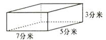

# Mathematics (Grade 5)

**ID**: 349c0254
**难度**: medium_hard
**题型**: short_answer

## 题目
计算下面长方体的表面积和体积。 

## 解答

**答案**: 142平方分米, 105立方分米

1. Step1:明确长方体表面积公式为（长×宽+长×高+宽×高）×2，体积公式为长×宽×高
2. Step2:确定该长方体的长为7分米，宽为5分米，高为3分米
3. Step3:根据表面积公式计算，即（7×5+7×3+5×3）×2 =（35+21+15）×2 =71×2 =142（平方分米）
4. Step4:根据体积公式计算，即7×5×3 =35×3 =105（立方分米）
5. Step5:得出表面积为142平方分米，体积为105立方分米

## 知识点

**知识点**:
  - 小学数学;图形与几何

---
