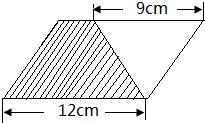

# Mathematics (Grade 5)

**ID**: 376afab7
**难度**: medium_hard
**题型**: short_answer

## 题目
在下图平行四边形中，空白部分三角形的面积是36cm$^{2}$，求阴影部分的面积．

## 解答

**答案**: 60

1. Step1:根据三角形面积公式S = 底×高÷2，已知空白部分三角形面积是36cm²，底是9cm，所以其高为36×2÷9 = 8厘米，此高也是平行四边形的高
2. Step2:计算阴影部分梯形的上底，由平行四边形底是12cm，空白三角形底是9cm，可得梯形上底为12 - 9 = 3厘米
3. Step3:根据梯形面积公式S=(上底 + 下底)×高÷2，梯形上底是3厘米，下底是12厘米，高是8厘米，所以阴影部分面积为[(12 - 9) + 12]×8÷2 = 60平方厘米

## 知识点

**知识点**:
  - 组合图形的面积．

---
