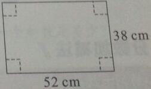

# Mathematics (Grade 5)

**ID**: 3a16bb98
**难度**: medium_hard
**题型**: short_answer

## 题目
有一块长52cm、宽38cm的长方形铁皮，在它的四个角分别剪去大小一样的正方形后，正好折成一个深5cm的无盖铁盒。求铁盒的表面积和体积。

 38cm  52cm

## 解答

**答案**: 1876(cm²), 5880(cm³)

1. Step1:计算折成铁盒后的长，52 - 5×2 = 42(cm)
2. Step2:计算折成铁盒后的宽，38 - 5×2 = 28(cm)
3. Step3:根据公式计算铁盒的表面积，42×28+(28×5 + 42×5)×2 = 1176+(140 + 210)×2 = 1176 + 700 = 1876(cm²)
4. Step4:根据公式计算铁盒的体积，42×28×5 = 5880(cm³)

## 知识点

**知识点**:
  - 

---
