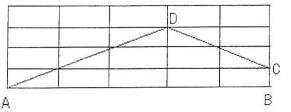

# Mathematics (Grade 5)

**ID**: 440723d4
**难度**: medium_hard
**题型**: short_answer

## 题目
下图中每个长方形的面积都是1平方厘米，A、B、C、D都是格子上的点，求四边形ABCD的面积。

## 解答

**答案**: 8.5

1. Step1:明确每个长方形面积为1平方厘米
2. Step2:使用拼凑法，将图形中不足一格的部分进行拼凑，得出四边形ABCD所占小长方形的个数为8.5个
3. Step3:根据每个小长方形面积为1平方厘米，计算四边形ABCD的面积为8.5×1 = 8.5平方厘米

## 知识点

**知识点**:
  - 割补法求组合图形的面积(奥数)

---
