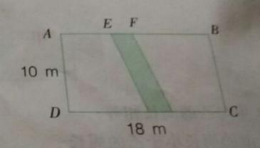

# Mathematics (Grade 5)

**ID**: 44769595
**难度**: medium_hard
**题型**: short_answer

## 题目
有一块长18m、宽10m的长方形空地，空地中有一条铺着石子的一条边是EF的平行四边形的路，EF的长是3m。空地的其他部分要铺草坪，如图所示。求这块空地应铺草坪的面积是多少。

## 解答

**答案**: 150

1. Step1:根据长方形面积公式S = a×b（其中a为长，b为宽），计算长方形空地面积，a = 18m，b = 10m，所以长方形空地面积为18×10 = 180平方米
2. Step2:根据平行四边形面积公式S = a×h（其中a为底，h为高），计算平行四边形路的面积，a = 3m，h = 10m，所以平行四边形路面积为3×10 = 30平方米
3. Step3:用长方形空地面积减去平行四边形路的面积，即180 - 30 = 150平方米，得到应铺草坪的面积

## 知识点

**知识点**:
  - --

---
