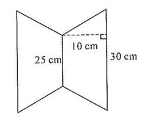

# Mathematics (Grade 5)

**ID**: 44eb9988
**难度**: medium_hard
**题型**: short_answer

## 题目
如图，某种女式皮包是由两块完全一样的梯形皮革制成的，缝制这样一个皮包需要多少平方厘米皮革．
   梯形的上底为25cm，下底为30cm，高为10cm．

## 解答

**答案**: 550

1. Step1:明确梯形面积公式为S=(上底+下底)×高÷2
2. Step2:已知梯形上底为25cm，下底为30cm，高为10cm，代入公式得到单个梯形面积S1=(25 + 30)×10÷2
3. Step3:因为皮包由两块完全一样的梯形皮革制成，所以总面积S = S1×2，即S=(25 + 30)×10÷2×2
4. Step4:先计算括号内25 + 30 = 55，得到S = 55×10÷2×2
5. Step5:计算55×10 = 550，得到S = 550÷2×2
6. Step6:计算550÷2×2 = 550，得到总面积为550平方厘米

## 知识点

**知识点**:
  - 第二单元 多边形的面积-
-

---
