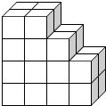

# Mathematics (Grade 5)

**ID**: 48026bb4
**难度**: medium_hard
**题型**: short_answer

## 题目
求如图的表面积（每个小正方体的棱长是1厘米）

## 解答

**答案**: 58

1. Step1:计算从上面和下面看到的面积，每个面面积为1×1 = 1平方厘米，上面和下面共8×2 = 16个面，面积为8×(1×1)×2 = 16平方厘米
2. Step2:计算从正面和后面看到的面积，每个面面积为1×1 = 1平方厘米，正面和后面共13×2 = 26个面，面积为2×13×(1×1) = 26平方厘米
3. Step3:计算从两个侧面看到的面积，每个面面积为1×1 = 1平方厘米，两个侧面共8×2 = 16个面，面积为2×8×(1×1) = 16平方厘米
4. Step4:将上面和下面、正面和后面、两个侧面看到的面积相加，16 + 26 + 16 = 58平方厘米，得到立体图形的表面积为58平方厘米

## 知识点

**知识点**:
  - 不规则立体图形的表面积

---
