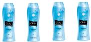

# Mathematics (Grade 5)

**ID**: 4b44dd4a
**难度**: medium_hard
**题型**: short_answer

## 题目
一瓶沐浴露有500毫升．
（1）4瓶这样的沐浴露有多少升？
（2）每瓶沐浴露售价10元，买一升这样的沐浴露需要多少钱？

## 解答

**答案**: 2, 20

1. Step1:计算4瓶沐浴露的总毫升数，根据乘法意义，用500×4=2000毫升
2. Step2:将2000毫升换算为升，因为1000毫升=1升，所以2000毫升=2升，得到4瓶沐浴露有2升
3. Step3:将500毫升换算为升，即500÷1000=0.5升
4. Step4:根据总价÷数量=单价，已知每瓶10元，数量是0.5升，用10÷0.5=20元，得到买一升沐浴露需要20元

## 知识点

**知识点**:
  - 整数的乘法及应用;体积、容积进率及单位换算

---
