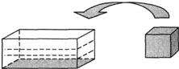

# Mathematics (Grade 5)

**ID**: 4b8f2abb
**难度**: medium_hard
**题型**: short_answer

## 题目
一只长方体的玻璃缸，长5dm、宽4dm、高3dm，水深2.5dm．如果投人一块棱长为3dm的正方体铁块，缸里的水会溢出多少升？

## 解答

**答案**: 17

1. Step1:计算正方体铁块的体积，根据正方体体积=边长×边长×边长，可得3×3×3=27立方分米
2. Step2:计算玻璃缸中剩余空间的体积，玻璃缸剩余高度为3 - 2.5 = 0.5分米，根据长方体体积=长×宽×高，可得5×4×0.5 = 10立方分米
3. Step3:计算溢出的水的体积，溢出的水的体积等于正方体铁块的体积减去玻璃缸中剩余空间的体积，即27 - 10 = 17立方分米
4. Step4:将体积单位立方分米转换为升，因为1立方分米=1升，所以17立方分米=17升

## 知识点

**知识点**:
  - 探索某些实物体积的测量方法．

---
