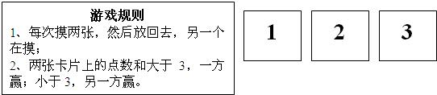

# Mathematics (Grade 5)

**ID**: 55ae621e
**难度**: medium_hard
**题型**: short_answer

## 题目
桌上有3张卡片，点数分1、2、3．

（1）先填写下表，然后想一想两张卡片上的点数之和有几种情况？
$\begin{array}{|c|c|c|c|}
\hline
点数 & 1 & 2 & 3 \\ \hline
1 & / & 3 &  \\ \hline
2 &  & / & 5 \\ \hline
3 &  & 5 & / \\ \hline
\end{array}$（2）这个游戏规则公平吗？如果这样的规则不公平，你能设计一个公平的规则吗？
（3）请你设计一个公平的规则：

## 解答

**答案**: 3, $\\frac{2}{3}$, 桌上有4张卡片，点数分1、2、3、4，如果摸到单数算自己赢，如果摸到双数算对方赢。

1. Step1:计算并填写表格，1+2=3，1+3=4，2+3=5，可得两张卡片上的点数之和有3、4、5这3种情况
2. Step2:计算两张卡片上的点数之和大于3的可能性，有4、5两种情况，共3种情况，所以可能性为2÷3=$rac{2}{3}$，而小于3的情况不存在，可能性是0，判断游戏规则不公平
3. Step3:设计公平规则，桌上有4张卡片，点数分1、2、3、4，摸到单数（1、3）算自己赢，摸到双数（2、4）算对方赢

## 知识点

**知识点**:
  - 游戏规则的公平性．

---
