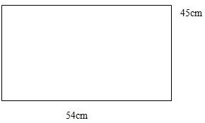

# Mathematics (Grade 5)

**ID**: 5765b475
**难度**: medium_hard
**题型**: short_answer

## 题目
有一张长方形的纸，长54cm，宽45cm，如果要剪成若干同样大小的正方形面，没有剩余，剪出的小正方形的边长最大是多少厘米？ 

## 解答

**答案**: 9

1. Step1:明确问题本质是求54和45的最大公因数
2. Step2:对54进行质因数分解，得到54=2×3×3×3
3. Step3:对45进行质因数分解，得到45=3×3×5
4. Step4:找出54和45公有的质因数为两个3
5. Step5:计算公有的质因数的乘积，即3×3=9，得出54和45的最大公因数为9，也就是小正方形的边长最大是9厘米

## 知识点

**知识点**:
  - 公因数和公倍数应用题．

---
