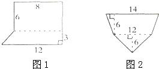

# Mathematics (Grade 5)

**ID**: 587a99f7
**难度**: medium_hard
**题型**: short_answer

## 题目
求下面各个图形的面积．(单位：cm)

## 解答

**答案**: 78, 114

1. Step1:分析图1，将其拆分为长8厘米、宽6厘米的长方形和上底8厘米、下底12厘米、高3厘米的梯形
2. Step2:计算图1中长方形的面积，根据长方形面积公式S = a×b（a为长，b为宽），可得8×6 = 48平方厘米
3. Step3:计算图1中梯形的面积，根据梯形面积公式S = (a + b)×h÷2（a为上底，b为下底，h为高），可得(8 + 12)×3÷2 = 30平方厘米
4. Step4:计算图1的总面积，将长方形和梯形面积相加，48 + 30 = 78平方厘米
5. Step5:分析图2，将其拆分为上底12厘米、下底14厘米、高6厘米的梯形和底12厘米、高6厘米的三角形
6. Step6:计算图2中梯形的面积，根据梯形面积公式可得(12 + 14)×6÷2 = 78平方厘米
7. Step7:计算图2中三角形的面积，根据三角形面积公式S = a×h÷2（a为底，h为高），可得12×6÷2 = 36平方厘米
8. Step8:计算图2的总面积，将梯形和三角形面积相加，78 + 36 = 114平方厘米

## 知识点

**知识点**:
  - 组合图形的面积．

---
