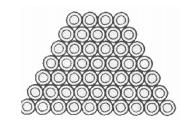

# Mathematics (Grade 5)

**ID**: 58e7ed23
**难度**: medium_hard
**题型**: short_answer

## 题目
解决问题。
仓库里堆放着一堆钢管（如下图），你能计算出一共有多少根吗？

## 解答

**答案**: 49

1. Step1:观察图形可知钢管的横截面是梯形，数出最上层钢管有4根，确定梯形上底为4
2. Step2:数出最下层钢管有10根，确定梯形下底为10
3. Step3:数出钢管层数为7层，确定梯形的高为7
4. Step4:根据梯形面积公式（上底+下底）×高÷2，代入上底4、下底10、高7，得到(10＋4)×7÷2
5. Step5:先计算括号内10 + 4 = 14，式子变为14×7÷2
6. Step6:计算14×7 = 98，式子变为98÷2
7. Step7:计算98÷2 = 49，得出钢管一共有49根

## 知识点

**知识点**:
  - 梯形的面积

---
