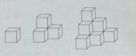

# Mathematics (Grade 5)

**ID**: 5ade2e9d
**难度**: medium_hard
**题型**: short_answer

## 题目
边长为1厘米的正方体，如图这样层层重叠放置.当重叠到6层时，这个立体图形的表面积是多少平方厘米？

## 解答

**答案**: 126

1. Step1:分析1层时，立体图形的表面积为6×1平方厘米
2. Step2:分析2层时，立体图形的表面积为6×(1 + 2)平方厘米
3. Step3:根据前面规律，推出6层时，立体图形的表面积为6×(1 + 2 + 3 + 4 + 5 + 6)平方厘米
4. Step4:计算1 + 2 + 3 + 4 + 5 + 6 = 21
5. Step5:计算6×21 = 126平方厘米

## 知识点

**知识点**:
  - --

---
