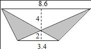

# Mathematics (Grade 5)

**ID**: 5f1aada4
**难度**: medium_hard
**题型**: short_answer

## 题目
求阴影部分的面积．（单位：cm）

## 解答

**答案**: 15.6

1. Step1:明确梯形的上底为8.6cm，下底为3.4cm，高为4 + 2 = 6cm，根据梯形面积公式S=(a + b)h÷2，其中a = 8.6，b = 3.4，h = 6，可得梯形面积为(8.6 + 3.4)×(4 + 2)÷2 = 12×6÷2 = 36平方厘米
2. Step2:明确第一个空白三角形的底为8.6cm，高为4cm，根据三角形面积公式S=ah÷2，其中a = 8.6，h = 4，可得其面积为8.6×4÷2 = 17.2平方厘米
3. Step3:明确第二个空白三角形的底为3.4cm，高为2cm，根据三角形面积公式S=ah÷2，其中a = 3.4，h = 2，可得其面积为3.4×2÷2 = 3.4平方厘米
4. Step4:根据阴影部分的面积=梯形的面积-两个空白三角形的面积，即36 - 17.2 - 3.4 = 15.6平方厘米

## 知识点

**知识点**:
  - 组合图形的面积．

---
