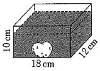

# Mathematics (Grade 5)

**ID**: 60d167c3
**难度**: medium_hard
**题型**: short_answer

## 题目
一个长方体水槽从里面量长18cm，宽12cm，高10cm，里面水深5cm，先将一个不规则的土豆放入水后，水面上升到7.5cm处.这个土豆的体积是多少？

 10cm  18cm  12cm

## 解答

**答案**: 540(cm³)

1. Step1:明确土豆的体积等于放入土豆后水上升的体积
2. Step2:计算水上升的高度，7.5 - 5 = 2.5cm
3. Step3:根据长方体体积公式V = a×b×h（a为长，b为宽，h为高），已知水槽长18cm，宽12cm，水上升高度2.5cm，计算水上升的体积，即18×12×2.5
4. Step4:得出18×12×2.5 = 540cm³，所以土豆体积为540cm³

## 知识点

**知识点**:
  - 第3单元检测卷;

---
