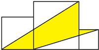

# Mathematics (Grade 5)

**ID**: 622d1007
**难度**: medium_hard
**题型**: short_answer

## 题目
如图，从左到右三个正方形的边长分别是6cm、8cm、4cm，求阴影部分的面积．

## 解答

**答案**: 48

1. Step1:计算边长为4cm的正方形的面积，根据正方形面积公式S=a×a，可得4×4=16平方厘米
2. Step2:计算边长为8cm的正方形的面积，根据正方形面积公式S=a×a，可得8×8=64平方厘米
3. Step3:计算长为8cm、宽为6cm的长方形的面积，根据长方形面积公式S=ab，可得6×8=48平方厘米
4. Step4:计算底为(4 + 8)cm、高为4cm的三角形的面积，根据三角形面积公式S=ah÷2，可得(4 + 8)×4÷2=24平方厘米
5. Step5:计算底为(8 + 6)cm、高为8cm的三角形的面积，根据三角形面积公式S=ah÷2，可得8×(8 + 6)÷2=56平方厘米
6. Step6:计算阴影部分面积，用前面算出的两个正方形面积与长方形面积之和减去两个三角形面积，即16 + 64 + 48 - 24 - 56=48平方厘米

## 知识点

**知识点**:
  - 组合图形的面积．

---
