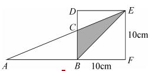

# Mathematics (Grade 5)

**ID**: 62e1522c
**难度**: medium_hard
**题型**: short_answer

## 题目
图中阴影部分的面积是30cm$^{2}$，AB的长是15cm，求空白部分的面积。

## 解答

**答案**: 115

1. Step1:根据三角形面积公式，已知△BCE面积为30cm²，高EF为10cm，计算BC的长度，即BC = 30×2÷10 = 6cm
2. Step2:根据三角形面积公式，计算△ABC的面积，底AB为15cm，高BC为6cm，所以△ABC的面积 = 15×6÷2 = 45cm²
3. Step3:根据正方形面积公式，计算正方形BFED的面积，边长BF为10cm，所以正方形BFED的面积 = 10×10 = 100cm²
4. Step4:计算空白部分的面积，空白部分的面积 = △ABC的面积 + 正方形BFED的面积 - △BCE的面积，即45 + 100 - 30 = 115cm²

## 知识点

**知识点**:
  - 三角形的面积;长方形与正方形的面积

---
