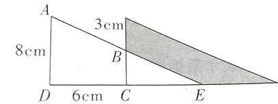

# Mathematics (Grade 5)

**ID**: 660ffc9a
**难度**: medium_hard
**题型**: short_answer

## 题目
如图是由两个相同的直角三角形叠放在一起形成的，求阴影部分的面积．

## 解答

**答案**: 39

1. Step1:根据两个相同的直角三角形去掉相同部分三角形BCE后剩下图形面积相等，可知阴影部分面积等于梯形ABCD的面积
2. Step2:计算梯形ABCD的上底，由8 - 3 = 5厘米
3. Step3:根据梯形面积公式，计算梯形ABCD的面积，即(5 + 8)×6÷2 = 13×6÷2 = 39平方厘米，此面积即为阴影部分面积

## 知识点

**知识点**:
  - 梯形的面积

---
