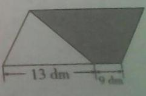

# Mathematics (Grade 5)

**ID**: 6bdaa95c
**难度**: medium_hard
**题型**: short_answer

## 题目
如图，三角形的面积是78dm²，求阴影部分的面积．

 13dm  9dm

## 解答

**答案**: 186

1. Step1:根据三角形面积公式三角形的面积=底×高÷2，已知三角形面积是78dm²，底是13dm，计算三角形的高，即78÷13×2=12（dm）
2. Step2:确定阴影部分是梯形，其梯形上底为9dm，下底为13 + 9 = 22dm，高为前面算出的12dm
3. Step3:根据梯形面积公式梯形面积=(上底＋下底)×高÷2，计算阴影部分面积，即(9 + 13 + 9)×12÷2 = 31×12÷2 = 186（dm²）

## 知识点

**知识点**:
  - --

---
