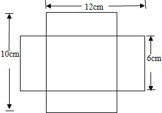

# Mathematics (Grade 5)

**ID**: 6fc73093
**难度**: medium_hard
**题型**: short_answer

## 题目
下面是一个无盖长方体纸盒的表面展开图，请计算出纸盒的面积和体积．

## 解答

**答案**: 124, 120

1. Step1:由展开图可知，长方体的高为(10 - 6)÷2 = 2厘米
2. Step2:长方体的长为12 - 2 = 10厘米
3. Step3:根据无盖长方体纸盒面积公式，其面积为(10×6 + 10×2 + 6×2)×2 - 10×6 = 124平方厘米
4. Step4:根据长方体体积公式，其体积为10×6×2 = 120立方厘米

## 知识点

**知识点**:
  - 长方体和正方体的体积;长方体的展开图;长方体和正方体的表面积

---
