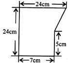

# Mathematics (Grade 5)

**ID**: 6ff783a8
**难度**: medium_hard
**题型**: short_answer

## 题目
计算如图的面积．

## 解答

**答案**: 329.5

1. Step1:根据图形可知，组合图形可分成一个长7厘米、宽5厘米的长方形和一个上底7厘米、下底24厘米、高为24 - 5 = 19厘米的梯形
2. Step2:根据长方形面积公式S = a×b（a为长，b为宽），计算长方形面积为7×5 = 35平方厘米
3. Step3:根据梯形面积公式S=(a + b)×h÷2（a为上底，b为下底，h为高），计算梯形面积为(7 + 24)×19÷2 = 31×19÷2 = 294.5平方厘米
4. Step4:将长方形面积与梯形面积相加，得到组合图形面积为35 + 294.5 = 329.5平方厘米

## 知识点

**知识点**:
  - 组合图形的面积．

---
