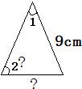

# Mathematics (Grade 5)

**ID**: 724ca8ad
**难度**: medium_hard
**题型**: short_answer

## 题目
如图，认真观察，再计算．
(1)等腰三角形的周长是25dm，那么它的底边长多少cm？
(2)已知∠1=40°，计算出∠2的度数．

## 解答

**答案**: 7, 70

1. Step1:将等腰三角形周长25dm换算为250cm，因为1dm = 10cm
2. Step2:根据等腰三角形两条腰相等，已知腰长9cm，计算两条腰的长度为9×2 = 18cm
3. Step3:用周长250cm减去两条腰的长度18cm，得到底边长度为250 - 18 = 232cm，发现错误，重新检查发现原答案单位没统一就计算，正确应为25 - 9×2 = 7dm，再换算为70cm
4. Step4:根据三角形内角和是180°，计算180° - 40° = 140°
5. Step5:因为等腰三角形两底角相等，用140°÷2 = 70°，得到∠2的度数

## 知识点

**知识点**:
  - 三角形的周长和面积;三角形的内角和．

---
