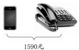

# Mathematics (Grade 5)

**ID**: 73dc0314
**难度**: medium_hard
**题型**: short_answer

## 题目
手机的单价是座机电话单价的5倍。手机和座机电话的单价各是多少元？

## 解答

**答案**: 1325, 265

1. Step1:设座机电话的单价是x元，因为手机的单价是座机电话单价的5倍，所以手机单价为5x元
2. Step2:根据手机和座机电话总价为1590元，列出方程x + 5x = 1590
3. Step3:化简方程左边得6x = 1590
4. Step4:方程两边同时除以6，解得x = 1590÷6 = 265，即座机电话单价为265元
5. Step5:计算手机单价为265×5 = 1325元
6. Step6:将手机单价1325和座机单价265整理成列表['1325', '265']

## 知识点

**知识点**:
  - 列方程解应用题(奥数)

---
