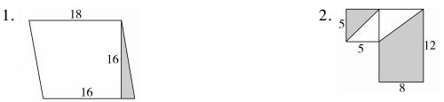

# Mathematics (Grade 5)

**ID**: 756a1057
**难度**: medium_hard
**题型**: short_answer

## 题目
求下列图形中阴影部分的面积。（单位：米）

## 解答

**答案**: 16, 12.5, 76, 88.5

1. Step1:计算第一个图形中阴影部分面积，先求底边长为18 - 16 = 2米，再根据三角形面积公式可得面积为2×16÷2 = 16平方米
2. Step2:计算第二个图形中边长为5的正方形内阴影三角形面积，根据三角形面积公式可得面积为5×5÷2 = 12.5平方米
3. Step3:计算第二个图形中梯形阴影部分面积，先求上底为12 - 5 = 7米，下底为12米，高为8米，根据梯形面积公式可得面积为(7 + 12)×8÷2 = 76平方米
4. Step4:计算第二个图形中阴影部分总面积为12.5 + 76 = 88.5平方米

## 知识点

**知识点**:
  - 梯形的面积;三角形的面积

---
