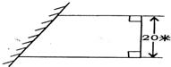

# Mathematics (Grade 5)

**ID**: 79e1ddc0
**难度**: medium_hard
**题型**: short_answer

## 题目
用篱笆围成一个梯形养鸡场（如图所示），其中一边利用房屋墙壁，已知篱笆的长是80米，求养鸡场的面积？

## 解答

**答案**: 600

1. Step1:明确篱笆长80米，其中一边20米利用房屋墙壁，所以梯形上底与下底的和为80 - 20 = 60米
2. Step2:已知梯形的高是20米，根据梯形面积公式S=(a + b)×h÷2（其中a + b为上底与下底的和，h为高），这里a + b = 60米，h = 20米，可得面积为60×20÷2
3. Step3:计算60×20÷2 = 1200÷2 = 600平方米

## 知识点

**知识点**:
  - 梯形的面积．

---
