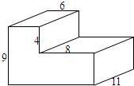

# Mathematics (Grade 5)

**ID**: 7b230fcb
**难度**: medium_hard
**题型**: short_answer

## 题目
求下列组合体的体积．（单位：分米）

## 解答

**答案**: 1034

1. Step1:计算长为6+8=14分米、宽为11分米、高为9-4=5分米的长方体体积，根据长方体体积公式v=abh，可得体积为14×11×5=770立方分米
2. Step2:计算长为11分米、宽为6分米、高为4分米的长方体体积，根据长方体体积公式v=abh，可得体积为11×6×4=264立方分米
3. Step3:将两个长方体体积相加，770+264=1034立方分米，得到组合体体积

## 知识点

**知识点**:
  - 组合图形的体积

---
