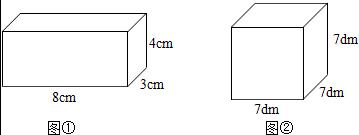

# Mathematics (Grade 5)

**ID**: 7b8d3354
**难度**: medium_hard
**题型**: short_answer

## 题目
计算图①的体积和图②的表面积．

     。

## 解答

**答案**: 96, 294

1. Step1:明确图①是长方体，其长为8cm，宽为3cm，高为4cm，根据长方体体积公式v = abh，其中a = 8，b = 3，h = 4，可得体积为8×3×4 = 96立方厘米
2. Step2:明确图②是正方体，其棱长为7dm，根据正方体表面积公式s = 6a²，其中a = 7，可得表面积为6×7² = 6×49 = 294平方厘米
3. Step3:提取长方体体积计算结果96和正方体表面积计算结果294，组成列表['96', '294']

## 知识点

**知识点**:
  - 长方体和正方体的体积;长方体和正方体的表面积．

---
