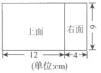

# Mathematics (Grade 5)

**ID**: 7d70f201
**难度**: medium_hard
**题型**: short_answer

## 题目
小明从一个长方体纸盒上撕下两个相邻的面（展开后如图）。求纸盒的表面积。

## 解答

**答案**: 384(cm$^{2}$)

1. Step1:明确长方体表面积公式为$S=(ab + ac + bc)×2$，其中$a$、$b$、$c$分别为长方体的长、宽、高
2. Step2:由图可知长方体的长$a = 12$cm，宽$b = 9$cm，高$c = 4$cm
3. Step3:将$a = 12$、$b = 9$、$c = 4$代入表面积公式，得到$(12×9 + 12×4 + 4×9)×2$
4. Step4:先计算括号内的值，$12×9 = 108$，$12×4 = 48$，$4×9 = 36$
5. Step5:计算括号内求和，$108 + 48 + 36 = 192$
6. Step6:计算$192×2 = 384$，单位为$cm^{2}$

## 知识点

**知识点**:
  - 小学数学;图形与几何;立体图形;长方体和正方体;长方体的展开图;长方体的表面积

---
