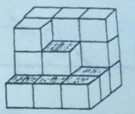

# Mathematics (Grade 5)

**ID**: 7e0c9305
**难度**: medium_hard
**题型**: short_answer

## 题目
把18个变长一厘米的正方体像右图那样叠放起来，你能很快求出它的表面积吗？

## 解答

**答案**: 50

1. Step1:计算每个小正方体一个面的面积，由1×1=1平方厘米
2. Step2:分析图形的面，从左边看有7个面，右边7个面，前边9个面，后边9个面，上面9个面，下面9个面
3. Step3:计算总面数，7+7+9+9+9+9=50个面
4. Step4:计算图形的表面积，50×1=50平方厘米

## 知识点

**知识点**:
  - --

---
