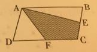

# Mathematics (Grade 5)

**ID**: 7e7963a2
**难度**: medium_hard
**题型**: short_answer

## 题目
如图所示，平行四边形的面积64cm²，E、F分别是BC和BD的中点，求图中阴影部分的面积.

## 解答

**答案**: 32(平方厘米)

1. Step1:明确三角形ADF的底是平行四边形底的一半，高与平行四边形的高相等，根据三角形面积公式S = 1/2×底×高，平行四边形面积公式S = 底×高，可得三角形ADF面积是平行四边形面积的1/4
2. Step2:明确三角形ABE的底是平行四边形底的一半，高与平行四边形的高相等，同理可得三角形ABE面积是平行四边形面积的1/4
3. Step3:计算三角形ADF和三角形ABE的面积和，为平行四边形面积的1/4×2
4. Step4:用平行四边形的面积64cm²减去三角形ADF和三角形ABE的面积和，即64 - 64×1/4×2
5. Step5:计算64 - 64×1/4×2 = 64 - 32 = 32(平方厘米)，得到阴影部分面积

## 知识点

**知识点**:
  - --

---
